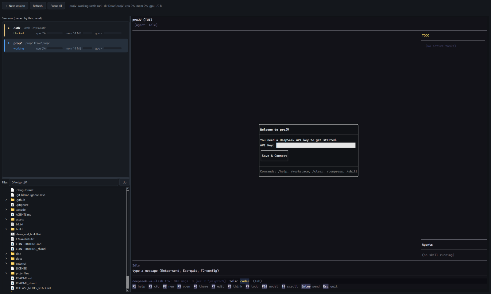

# Ostlr

**English** | [中文](README_zh.md)

One window for the AI agent sessions you run on this machine: what is running,
what is **waiting for you**, and one click to focus, kill or start another - each
in a real terminal the panel owns.



Three proJV sessions in three directories, each with a live CPU and memory
reading; the right dock is the file tree of the directory the selected session
runs in; the receipt line shows an OSC 7501 report arriving from the program.

Self-use tool. No cloud, no telemetry, no account.

## What it does

- **A real terminal, and only that.** The list holds the panes this panel started:
  it owns their PTYs (ConPTY), so it can size them, read their bytes, answer
  protocol probes and type into them. A process it did not start is not listed -
  the panel does not claim to manage what it cannot see inside.
- **State you can check.** `working` while output flows; when the child goes quiet
  the pane **withdraws its claim** and the row falls back to `unknown`, because
  silence is not idleness - an agent waiting for an approval is silent too.
  `blocked` and `idle` come only from the program itself over OSC 7501 (proJV
  does this) or from a producer's status file. The program's words, never ours.
  A state that arrived that way is **held** for as long as the process lives.
- **Tabs.** Each tab is one session; the tabs, their commands and their
  directories come back on the next start.
- **You say what runs.** The launcher lists the programs in `config.toml`;
  *Browse...* picks an exe, and that pick is written back as a `[[agents]]` entry.
  It also states out loud which copy of the exe will run and whether that copy has
  an API key - before the click, not after.
- **Looks like your terminal.** The pane uses the OS terminal's own font (read
  from Windows Terminal's settings) and lets the terminal draw its own frame, so a
  TUI hosted here looks like the same TUI outside -
  [`docs/parity.md`](docs/parity.md) records the measurements behind that.
- **Tray.** A tray badge counts what waits.

### What it does not do, on purpose

It never looks at a session it did not start. There is no process scan and no
window-title guessing, so an agent running in Windows Terminal or an editor is not
in this list - the panel cannot type into it, size it, or read its bytes, and a row
you cannot act on is a row that teaches you to stop believing the list. Add a
program by choosing its exe once; that is the whole contract for what appears.

## Install

```
py -3 -m pip install -i https://mirrors.aliyun.com/pypi/simple/ -r requirements.txt
```

The mirror matters: the default index here serves only pure-Python wheels, so
`PySide6` and `pywinpty` look unavailable when they are not. `python` on this
machine is the Microsoft Store stub - always use `py -3`.

## Run

```
py -3 -m ostlr                 # the panel
py -3 -m ostlr --selftest      # headless PASS/SKIP lines
py -3 -m ostlr run -- <cmd>    # the producer wrapper
py -3 -m ostlr.status --list   # what the programs on this machine report
```

`--list` prints the status records that exist right now - who is reporting, from
where, how long ago, and what they said. It reads files, so it never guesses:
an empty list means nobody is talking, not that nothing is running. Add `--prune`
to delete the records of pids that are gone.

## Build the exe

```
py -3 tools\build_exe.py               # one folder, ~640 MB, starts in ~1 s
py -3 tools\build_exe.py --onefile     # one file, unpacks Chromium per start
```

`dist\ostlr\ostlr.exe`. Console build on purpose: the same binary answers
`--selftest` and `run`.

## How a session reports its state

| Level | Source | Status |
|---|---|---|
| **L1** | OSC 7501 over the PTY we own | **live**: the pane answers a probe and parses reports; proJV emits them (`L1: done: turn finished`) |
| **L2** | a JSON status file per pid | works, and the only source that can say `blocked` from outside a pane |
| **none** | nothing reported | the row says `unknown` with the reason, never `idle` |

A session started **in the panel** writes its own record (`source=ostlr-pane`)
while its child is producing output, and withdraws it when the child goes quiet.
A program that speaks OSC 7501 outranks that guess, and its report is kept until
the program says otherwise.

### The status file

`%LOCALAPPDATA%\ostlr\status\<pid>.json`, written with a temp file plus
`os.replace`:

```json
{"v": 1, "ts": "2026-10-30T20:11:03Z", "source": "claude-code", "pid": 12345,
 "cwd": "D:/ws/sop-test", "state": "blocked", "kind": "permission",
 "msg": "Approve rm -rf build?", "exit_code": 0}
```

Write one by hand:

```
py -3 -m ostlr.status --state blocked --kind permission --pid <pid> --msg "Approve rm -rf build?"
```

For a session you cannot start in the panel, the wrapper writes the same record
around any command, so its row stops reading `unknown`:

```
py -3 -m ostlr run -- <cmd>
```

The copy-paste recipe for a third-party CLI is in
[`docs/producers/claude-hook.md`](docs/producers/claude-hook.md) - marked
**unverified on this machine**, because no third-party hook exists here to fire.

## The honest limit

`blocked` needs a producer. A session started **in a pane** now has one: the pane
owns the PTY, answers the OSC 7501 probe and parses what the CLI reports (proJV
does this today), so its row is a report rather than a guess. A stock `claude` or
`codex` writes no status file and emits no sequence, so its row reads `unknown`
until something reports - the panel states this on screen rather than showing a
green row that means nothing. `unknown` is never rendered as `idle`, and nothing
here infers a state from a window title.

Two rendering rules matter as much as the state ladder, because both were visible
before they were understood (`docs/parity.md`): the terminal draws its own frame
(so a TUI's borders are continuous and its gauges are solid), and the default font
is the OS terminal's own, read from its settings - hosting a TUI here must not
change how it looks.

## Docs

- [`docs/parity.md`](docs/parity.md) - the rendering contract and the numbers
  behind it.
- [`docs/m1-notes.md`](docs/m1-notes.md) - M1 acceptance, kept as history.
- [`docs/producers/claude-hook.md`](docs/producers/claude-hook.md) - the L2 recipe.
- [`AGENTS.md`](AGENTS.md) - measured environment facts and the rules.

## Test

```
py -3 -m unittest discover -s tests -v
py -3 tools\parity_probe.py            # frame gaps and gauge fill, real pane
```

---

Powered by [proJV](https://github.com/MilesKHuang/proJV)
