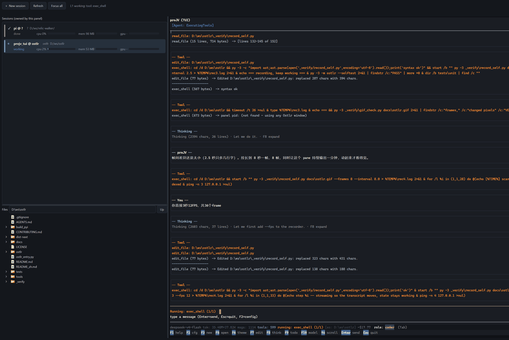

# Ostlr

**English** | [中文](README_zh.md)

A control panel for the AI agent sessions you run on this machine.



## Three things it does for you

- **The state and footprint of every TUI you run, at a glance.** One row per
  session: the harness state (a `blocked` row also says how long and what it
  asked), then CPU, memory and GPU each on its own line, so the length of a bar
  is the number.
- **Start, switch, close - all in hand.** Up to five panes; a TUI process starts
  here and is collected here, so none is left behind. A row carries two icons:
  open a terminal, close this session - closing states the process count and the
  memory first.
- **Files, images and folders - one icon to hand the path to a session.**
  The tree follows the selected session; every row ends with two icons that send
  `path` or `@path` into the focused pane, quoted when the path needs it.

`blocked` needs a producer: proJV, pi, Claude Code, Crush and opencode report by
themselves; anything else reads `unknown`, never rendered as `idle`.

## Start in three steps

1. **Install**:
   ```
   py -3 -m pip install -r requirements.txt
   ```
   In China - or when `PySide6` / `pywinpty` come back "not found" - add a
   mirror: `-i https://mirrors.aliyun.com/pypi/simple/`.
2. **Run**:
   ```
   py -3 -m ostlr
   ```
3. **Add your harness CLI**: `+ New session` -> `Browse...` -> pick the exe. It is
   written to `config.toml` as a `[[agents]]` entry.

## Beyond the basics

| Bonus | What it is |
|---|---|
| **The TUI/CLI reports its own state** | OSC 7501 ([Program Status Protocol](https://www.superlogical.com/rex/docs/build/program-status), rev 0.3) is **live**: [pi](https://github.com/earendil-works/pi) is verified. File format and wrapper: [status-levels](docs/producers/status-levels.md) |
| **Same rendering as the native TUI** | the terminal draws its own frame and the OS terminal's own font is used - [parity](docs/parity.md) |
| **Scriptable** | `py -3 -m ostlr.status --list` shows what the programs report right now (`--prune` drops dead pids); `py -3 -m ostlr run -- <cmd>` wraps a session you cannot start here; `--selftest` runs headless |
| **Or pack an exe** | build from the clean venv (see `docs/dev-machine.md`): one folder, ~610 MB, ~1 s start; `--onefile` for a single file |

---

Powered by [proJV](https://github.com/MilesKHuang/proJV)
