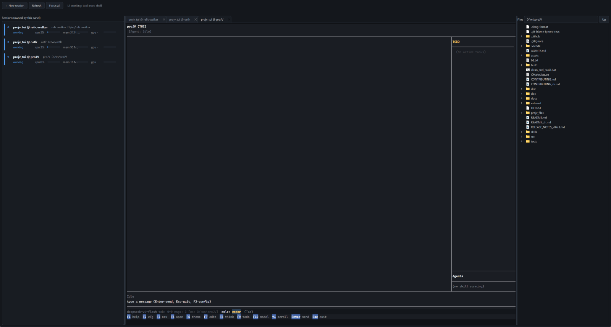

# Ostlr

[English](README.md) | **中文**

一个窗口，管住这台机器上你跑着的 AI agent 会话：谁在跑、谁**在等你**，一次点击就能聚焦、结束，或者再起一个——每一个都跑在面板自己拥有的真终端里。



图里是三个目录下各一个 proJV 会话，每个都有实时的 CPU 与内存读数；右侧停靠的是**选中会话所在目录**的文件树；顶栏那行回执是程序通过 OSC 7501 报上来的状态。

自用工具。无云端、无遥测、无账号。

## 它做什么

- **真终端，而且只有真终端。** 列表里的每一行都是这个面板自己启动的 pane：它拥有这些 pane 的伪终端（ConPTY），所以能决定尺寸、读字节、应答协议探测、往里打字。**它没启动的进程不会出现在列表里**——面板不假装管理自己看不进去的东西。
- **状态可以核对。** 有输出时才写 `working`；子进程安静下来，pane 就**撤回自己的说法**，行回到 `unknown`——安静不等于空闲，等审批的 agent 也是安静的。`blocked` 和 `idle` 只可能来自程序自己（OSC 7501，proJV 已经会发）或生产者写的状态文件。**是程序的话，不是我们的猜测。** 这样报上来的状态会**一直保持**，只要进程还活着。
- **标签页。** 一个标签一个会话；标签、启动命令、所在目录下次启动时原样回来。
- **跑什么由你定。** 启动器里列的是 `config.toml` 里的程序；`Browse...` 选一个 exe，这个选择会被写回成一条 `[[agents]]`。点之前就会告诉你**将要运行哪一份 exe、那一份有没有 API key**，不是点完之后才发现。
- **长得像你的终端。** pane 用的是**操作系统终端自己的字体**（从 Windows Terminal 的设置里读），框线也交给终端自己画，所以在这里跑的 TUI 和在外面跑的长得一样——测量过程和数字记在 [`docs/parity.md`](docs/parity.md)。
- **托盘。** 托盘徽标会数出有几个在等你。

### 它故意不做的事

它从不看自己没有启动的会话。没有进程扫描，也没有窗口标题猜测，所以在 Windows Terminal 或编辑器里跑着的 agent 不在这份列表里——面板没法往里打字、没法改它的尺寸、也没法读它的字节；一行你没法操作的记录，只会教你不要相信这份列表。想让一个程序出现，选一次它的 exe 就够了，这就是全部约定。

## 安装

```
py -3 -m pip install -i https://mirrors.aliyun.com/pypi/simple/ -r requirements.txt
```

镜像很关键：默认源在这台机器上只提供纯 Python 轮子，于是 `PySide6` 和 `pywinpty` 看起来"装不上"，其实不是。这台机器上的 `python` 是 Microsoft Store 的占位程序——**始终用 `py -3`**。

## 运行

```
py -3 -m ostlr                 # 面板
py -3 -m ostlr --selftest      # 无界面的 PASS/SKIP 行
py -3 -m ostlr run -- <cmd>    # 生产者包装器
py -3 -m ostlr.status --list   # 这台机器上的程序正在汇报什么
```

`--list` 打印此刻存在的状态记录：谁在汇报、从哪来、多久之前、说了什么。它只读文件，所以从不猜：列表为空就是**没人在说话**，不是"什么都没在跑"。加 `--prune` 会删掉那些进程已经不在的记录。

## 打包 exe

```
py -3 tools\build_exe.py               # 一个目录，约 640 MB，启动约 1 秒
py -3 tools\build_exe.py --onefile     # 单文件，每次启动解包 Chromium
```

产物 `dist\ostlr\ostlr.exe`。故意做成控制台程序：同一个二进制既能开面板，也能回答 `--selftest` 和 `run`。

## 会话怎么汇报状态

| 层级 | 来源 | 状态 |
|---|---|---|
| **L1** | 我们拥有的 PTY 上的 OSC 7501 | **已通**：pane 会应答探测、解析报文；proJV 就在发（`L1: done: turn finished`） |
| **L2** | 每个 pid 一个 JSON 状态文件 | 可用；也是 pane 之外唯一能说 `blocked` 的来源 |
| **无** | 什么都没报 | 行显示 `unknown` 并给出原因，**永远不是 `idle`** |

在**面板里**启动的会话，子进程有输出时会自己写记录（`source=ostlr-pane`），安静下来就撤回。会讲 OSC 7501 的程序优先级更高，它的报告会**一直保留**，直到程序自己改口。

### 状态文件

`%LOCALAPPDATA%\ostlr\status\<pid>.json`，用临时文件加 `os.replace` 写入：

```json
{"v": 1, "ts": "2026-10-30T20:11:03Z", "source": "claude-code", "pid": 12345,
 "cwd": "D:/ws/sop-test", "state": "blocked", "kind": "permission",
 "msg": "Approve rm -rf build?", "exit_code": 0}
```

手写一条：

```
py -3 -m ostlr.status --state blocked --kind permission --pid <pid> --msg "Approve rm -rf build?"
```

没法在面板里启动的会话，用包装器把任意命令包起来，它写的还是同一份记录，那一行就不再是 `unknown`：

```
py -3 -m ostlr run -- <cmd>
```

给第三方 CLI 的复制粘贴配方在 [`docs/producers/claude-hook.md`](docs/producers/claude-hook.md)，标注为**本机未验证**——这台机器上没有第三方 hook 可以触发它。

## 诚实的边界

`blocked` 需要一个生产者。在 **pane 里**启动的会话现在有了：pane 拥有 PTY、应答 OSC 7501 探测、解析 CLI 报的内容（proJV 今天就在这么做），所以那一行是**报告**，不是猜测。原生的 `claude` 或 `codex` 既不写状态文件也不发序列，那么它的行会一直是 `unknown` 直到有东西汇报——面板宁可在屏幕上说明这一点，也不肯显示一行毫无意义的绿色。`unknown` 永远不会被渲染成 `idle`，这里也没有任何东西会从窗口标题去推断状态。

还有两条渲染规则和状态阶梯同样重要，因为它们在没被理解之前就已经看得见了（见 [`docs/parity.md`](docs/parity.md)）：**框线由终端自己画**（所以 TUI 的边框连续、进度条实心），**默认字体是操作系统终端自己的**（从它的设置里读）——在这里托管一个 TUI，不能改变它长什么样。

## 文档

- [`docs/parity.md`](docs/parity.md) —— 渲染契约和它背后的实测数字。
- [`docs/m1-notes.md`](docs/m1-notes.md) —— M1 的验收记录，当历史读。
- [`docs/producers/claude-hook.md`](docs/producers/claude-hook.md) —— L2 配方。
- [`AGENTS.md`](AGENTS.md) —— 实测出来的环境事实和规则。

## 测试

```
py -3 -m unittest discover -s tests -v
py -3 tools\parity_probe.py            # 真 pane 里的框线缝隙与进度条填充率
```
